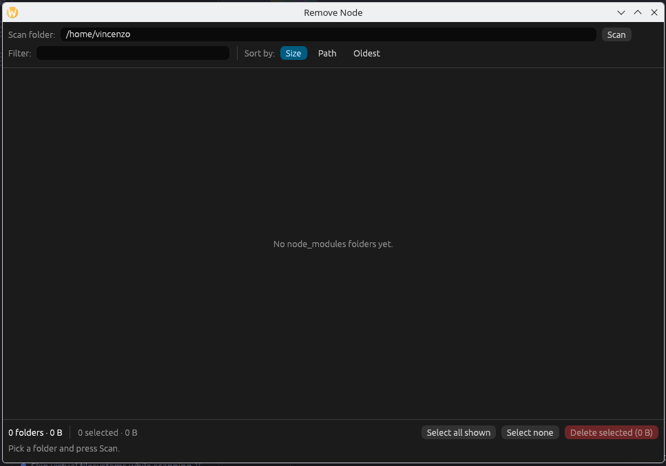

# Remove Node

A small desktop app that finds every `node_modules` folder under a directory, shows how much disk space each one uses, and deletes the ones you pick.



## Features

- **Scan any folder.** Defaults to your home directory. You can cancel a scan at any time.
- **Real disk usage.** Sizes count the bytes actually used on disk, not just file lengths.
- **Top-level folders only.** Nested `node_modules` inside a `node_modules` folder are counted toward their parent, not listed separately.
- **Sort and filter.** Sort by size, path or age (oldest first), and filter the list by path.
- **Bulk delete.** Select folders one by one or select everything shown, see the total you'll free up, and confirm before anything is removed.
- **Safe traversal.** Symlinks aren't followed, and virtual filesystems such as `/proc`, `/sys` and `/dev` are skipped.

## Building

Requires a recent stable Rust toolchain (the crate uses the 2024 edition).

```sh
git clone https://github.com/vinisadev/remove-node.git
cd remove-node
cargo build --release
```

The binary is written to `target/release/remove-node`.

## Usage

```sh
cargo run --release
```

1. Enter the folder to scan and press **Scan** (or hit Enter).
2. Wait for the scan to finish, or press **Cancel** to stop early.
3. Tick the folders you want to remove, or use **Select all shown** after filtering.
4. Press **Delete selected** and confirm.

Deleted folders are removed permanently, not moved to the trash. You can restore a project's dependencies by running `npm install` (or your package manager's equivalent) again.

## Running tests

```sh
cargo test
```

## Built with

- [egui / eframe](https://github.com/emilk/egui) for the UI
